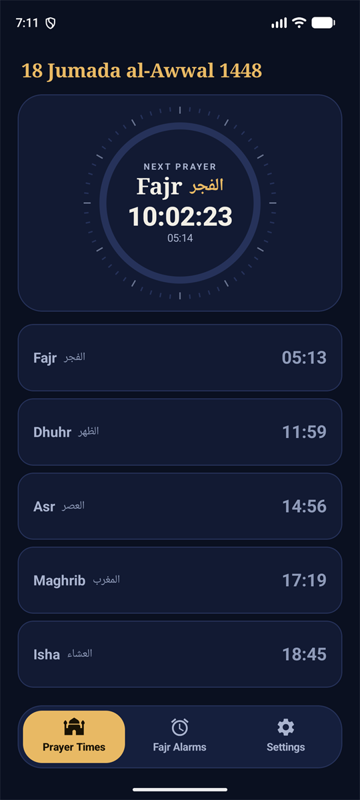
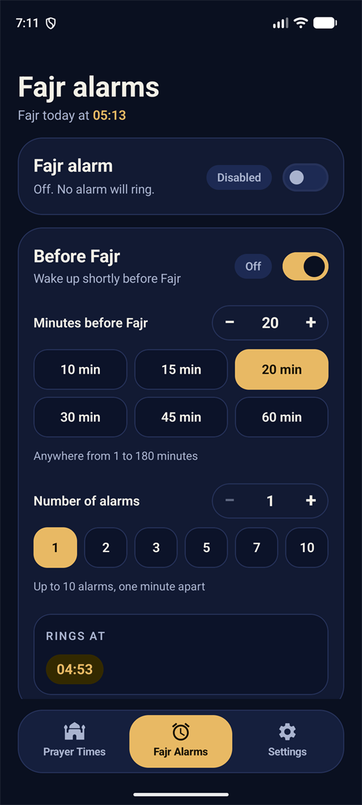
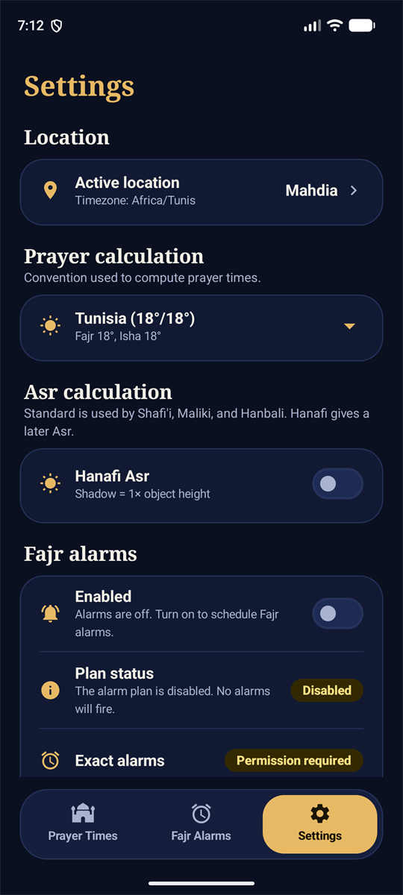
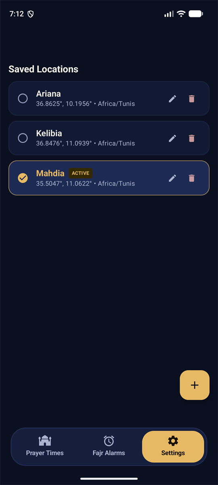
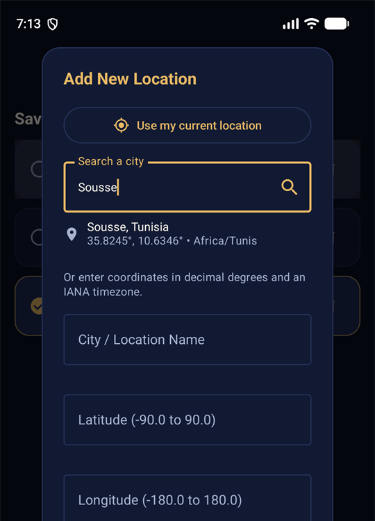
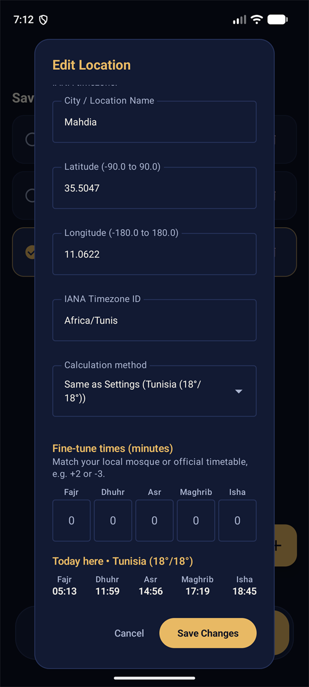

<div align="center">


# Adhan

**Accurate prayer times and Fajr alarms for Android.**

Free and open source. No login, no subscription, no ads.

[](LICENSE)


</div>

---

## Why Adhan

- **100% free.** No subscription, no in-app purchases, no premium tier. Every feature is for everyone.
- **No account.** Nothing to sign up for or log in to. Install it and it works.
- **No ads, no tracking.** The app doesn't even have the internet permission, so Android
  itself prevents it from sending your data anywhere.
- **Open source.** All the code is here under the [MIT license](LICENSE): read it, check it,
  improve it, share it.
- **Works offline.** Prayer times are calculated on your phone, so alarms ring even in airplane mode.

## Screenshots

<table>
  <tr>
    <td align="center"><br><sub>Today's times and countdown</sub></td>
    <td align="center"><br><sub>Fajr alarms</sub></td>
    <td align="center"><br><sub>Settings</sub></td>
  </tr>
  <tr>
    <td align="center"><br><sub>Saved locations</sub></td>
    <td align="center"><br><sub>Find a city or use your location</sub></td>
    <td align="center"><br><sub>Fine-tune times to your mosque</sub></td>
  </tr>
</table>

## Features

- **Prayer times calculated on your phone** with the
  open-source [adhan-java](https://github.com/batoulapps/adhan-java) astronomical library
  by Batoul Apps. Choose the method
  (Tunisia 18°/18° by default, Muslim World League, Egyptian, Karachi, Umm al-Qura, ISNA)
  and Shafi'i or Hanafi Asr.
- **Next-prayer countdown** on the home screen, plus an optional notification, with the Hijri date.
- **Saved locations** (Mahdia, Ariana and Kelibia included). Add a new one by:
  - tapping **Use my current location** (one tap, approximate location is enough),
  - **searching a city** by name, or
  - typing latitude, longitude and timezone yourself.
- **Exact times for each location.** Give a location its own calculation method and adjust
  each prayer by a few minutes (for example Fajr +2, Isha −3) to match your mosque or official
  timetable. A live preview shows today's times while you edit.
- **Fajr alarms**: wake up before Fajr, for Qiyam al-Layl, or with a series of alarms around
  Fajr. They use exact alarms and come back after a restart.
- **Works everywhere,** including far north and south: when the sun doesn't rise or set,
  times follow the nearest latitude where it does.

## Install

1. Download the latest `Adhan-<version>.apk` (for example `Adhan-1.0.apk`) from the
   [Releases page](https://github.com/shnefix/Adhan/releases).
2. Open it on your phone. If asked, allow your browser or file manager to "install unknown apps".
3. Open **Adhan**, pick or add your location, and turn on Fajr alarms if you want them.

Requires Android 8.0 or newer.

## Privacy

| The app… | |
| :--- | :--- |
| Needs an account | No |
| Shows ads | No |
| Has the internet permission | No |
| Collects or shares data | No |
| Uses location | Only when you tap "Use my current location" (once, approximate is enough) |

Everything you save (locations, alarm settings) stays on your phone.

## Build from source

Requirements: Android Studio (or the Android SDK) and JDK 17.

```bash
./gradlew assembleDebug
```

```bash
./gradlew installDebug
```

To build a signed release APK, copy `keystore.properties.example` to `keystore.properties`,
point it at your signing key, then:

```bash
./gradlew assembleRelease
```

### Tests

```bash
./gradlew testDebugUnitTest
```

On-device tests (database migrations) need an emulator or a connected phone:

```bash
./gradlew connectedDebugAndroidTest
```

### Project layout

```
app/src/main/java/com/example/prayeralarm/
  domain/       prayer time calculation, alarm planning, models
  data/         Room database, DataStore preferences, repositories, location lookup
  alarm/        AlarmManager scheduling, ringing service, notifications, boot recovery
  ui/           Jetpack Compose screens (home, locations, alarms, settings)
app/schemas/    exported Room schemas, one JSON file per database version (commit these)
docs/           detailed documentation, start at docs/README.md
```

When you change a Room entity, bump the database version in `PrayerAlarmDatabase`, add a
`Migration`, and extend `PrayerAlarmDatabaseMigrationTest`.

More in [docs/README.md](docs/README.md) (architecture, calculation, design decisions) and
[docs/CHANGELOG.md](docs/CHANGELOG.md).

## Contributing

Issues and pull requests are welcome, especially corrections to prayer times for your city.
If you report a time difference, please include the location, the date, the official
timetable you compared with, and the calculation method you used.

## License

[MIT](LICENSE). Free to use, change and share.
